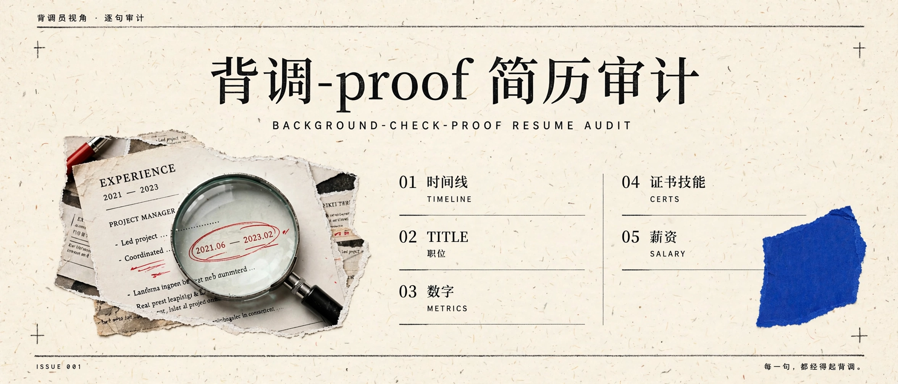

<p align="center">
  
</p>

<p align="center">
  <strong>Every line survives verification.</strong>
</p>

<p align="center">
  <a href="https://github.com/caihhhhhh/background-check-audit/actions/workflows/ci.yml"></a>
  <a href="https://developers.openai.com/codex"></a>
  <a href="https://docs.anthropic.com/en/docs/claude-code"></a>
  <a href="https://www.python.org/"></a>
  <a href="LICENSE"></a>
</p>

<p align="center">
  <a href="README.zh-CN.md">中文</a> ·
  <a href="#install">Install</a> ·
  <a href="#how-it-works">How it works</a>
</p>

# Background-Check-Proof Resume Audit

> Can every line on your resume survive a background check?

Background checks keep getting stricter. Third-party firms verify your companies, titles, dates, and salary one by one — an offer can be revoked after it's signed.

This skill reads your resume **the way a background-check investigator would**, line by line, and finds the spots where you'd get stuck.

One thing upfront: it doesn't teach you to fake anything. It finds the risks so you can fix them honestly — delete them, rewrite them truthfully, or prepare real evidence.

## What it checks

- **Timeline** — are your dates right? Any overlapping jobs? Any gap you're hoping nobody notices?
- **Titles** — "Specialist" inflated to "Manager"? One org-chart pull exposes it.
- **Numbers** — for every metric, can you point to the evidence? "300% growth" — from 1 to 4 is also 300%.
- **Skills & certs** — the things you claim to "master": could you answer a deep question? Are the certs still valid?
- **Salary** — inflate by 20%+ and the bank statement kills it. Risk flag only, no coaching.

## How it works

```bash
# 1. Start an audit
python scripts/bg_audit.py new --resume resume.pdf --name my-audit

# 2. Timeline check (automatic: overlaps, gaps, fuzzy dates)
python scripts/bg_audit.py timeline my-audit/

# 3. The agent audits claim by claim, like an investigator, into audit-ledger.json

# 4. Render the report
python scripts/bg_audit.py report my-audit/ --output audit-report.md
```

## What the report looks like

Every risk comes with four things: the original sentence, how a check would verify it, where the risk is, and how to fix it — sorted by risk level.

It ends with one test:

> If your former manager sat across from you, could you read every line of your resume out loud?

If yes — you're background-check-proof.

## Who it's for

- Job seekers who don't want to blow up at the background-check stage
- Resume coaches and career consultants
- Anyone who had AI write their resume and isn't sure which lines hold up

## Relation to ResumeProof Match

`resume-proof-match` makes every claim traceable to evidence ("write it true"); this one makes every claim survive verification ("check it hard"). Use both for the full loop from writing to background check.

## Install

```bash
npx skills add caihhhhhh/background-check-audit -g
```

Then tell your agent:

> Use background-check-audit to audit my resume like a background-check investigator, line by line, and tell me where the risks are.

## Principles

- Risk flags and honest fixes only. No grey-area coaching on passing checks.
- Risk levels are categories, not probabilities — no made-up "pass rates".
- Your resume is processed locally. Nothing is uploaded anywhere.

---

Open source (MIT) · 中文: [README.zh-CN.md](README.zh-CN.md)
